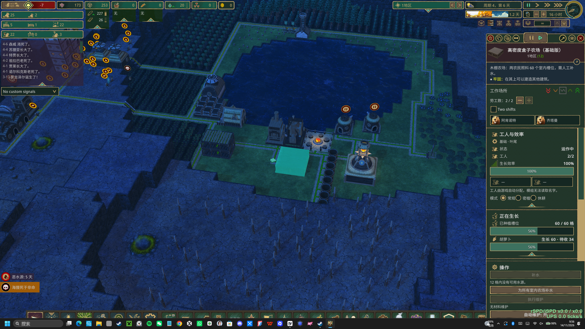
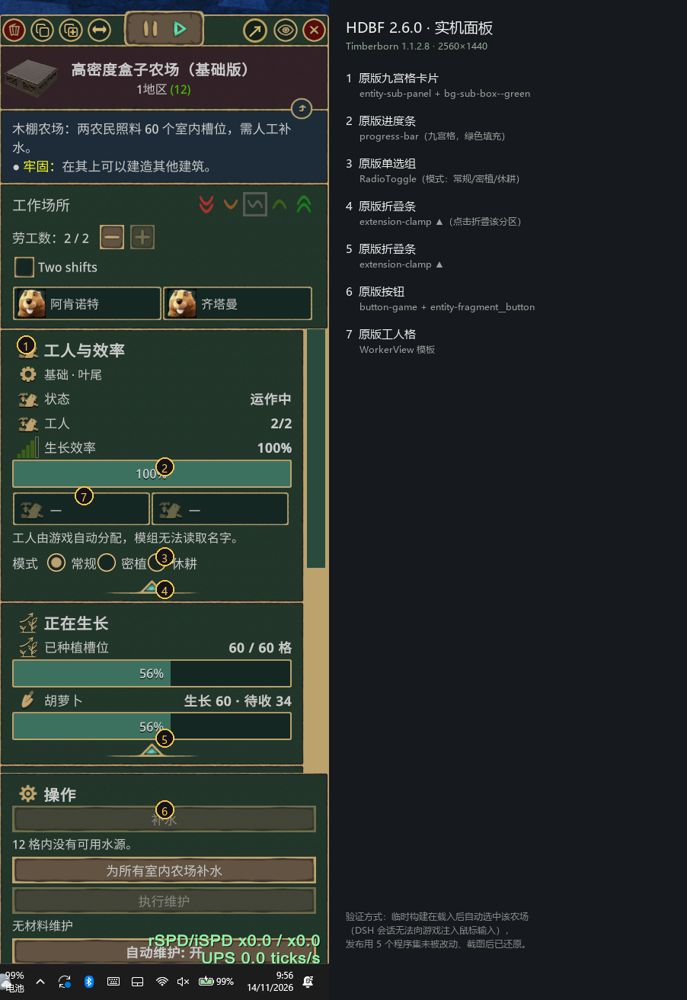

# 高密度盒子农场（HDBF）— Timberborn 模组

> 按需求蓝图 §19（v2.1）实现的 Timberborn 1.1.2.8 模组：**3×3×1 室内高密度农场**。
> 本工程不是文档摘要，而是可构建、可测试、可安装的代码与数据。
>
> **当前版本 2.6.0（v2 室内版 · 2026-11-14 UI/GUI 原版化 + 可折叠分区，已发布 Steam Workshop item 3828809784）**：四档 3×3×1 建筑，内部 60/150/300/600 个抽象槽位，
> 平屋顶可叠放，内部水罐 + 管道/人工补水；v1 的世界地块扫描、托管格、原版种植派发、
> 地块高亮、作物可见性补丁与 Harmony 补丁**已全部删除（0 Harmony）**。
> v2 设计入口：[docs/v2/README.md](docs/v2/README.md)、需求唯一来源 [§19](docs/REQ_V2_SECTION_19.md)。

| 项目 | 值 |
|---|---|
| 模组版本 | **2.6.0（v2；UI/GUI 原版化 + 可折叠分区，已发布 Steam Workshop item 3828809784）** |
| 目标游戏 | Timberborn 1.1.2.8（`1.1.2.8-ffc2de0-sw`，Unity 6000.5.11f1） |
| 存档 schema | **2**（每建筑一条原生持久化记录，含 v1→v2 迁移；见 ADR-V2-003） |
| 配置 schema | **2**（v1 配置可读并迁移；未知键忽略） |
| 程序集 | `HDBF.Core` / `HDBF.Persistence` / `HDBF.Gameplay` / `HDBF.Integration` / `HDBF.UI` |
| Harmony 补丁 | **0** |
| L1 测试 | **733**（零游戏依赖，`FAILED 0`） |
| 发布门禁 | **PASSED (44 checks)** + `NFR GATE MATRIX: PASSED` |

## 0. 实机截图（2.6.0）





> 2560×1440 · Timberborn 1.1.2.8 · 2.6.0 已发布包（`ManifestID 4848736136601558932`）。
> 截图方式、证据与还原核对见 [VERIFICATION §52.1](docs/VERIFICATION.md)。

## 1. 这是什么

四档「盒子农场」建筑（基础/中级/高级/顶级），把大量分散农田压缩进一栋 **3×3×1** 的建筑内部：

- 基础版 60 槽 / 2 工人 / C_min 50% / 水罐 3.6
- 中级版 150 槽 / 4 工人 / 60% / 10.8
- 高级版 300 槽 / 8 工人 / 75% / 33.6
- 顶级版 600 槽 / 16 工人 / 80% / 76.8 + 150 动力（或离网 15 金属/8 日）

作物在建筑**内部槽位**模拟生长（读取原版作物 spec 的生长天数/产量/产物），
农民只占建筑工作位；水由**内部水罐**提供（管道自动补水或工人人工补水）；
产物进入建筑输出库存后由原版搬运/传送带送出。模型屋顶是**平的、可通行、可叠放建筑**。

- **2.6.0 改版（UI/GUI 原版化 + 可折叠分区，2026-11-14；已发布 Steam Workshop，ManifestID `4848736136601558932`）：** 玩家要求「把 UI 和 GUI 都原版化，收缩型菜单也是」。考察（原版 1.1.2.8 UI 拆包 `~/.hdbf/ref/UI/Views` + 现有面板逐行审计）：面板有 30 处视觉偏差，其中 13 处是自订的——自订暖白文字色 `#F2EBDD`（原版 `.entity-panel__text` 是 `rgb(204,204,204)`）、`#C4562B` 三像素警告色条 + `▲/!` 文字标记（原版是红条纹 status 卡片 + `StatusListElement`）、强制字号/间距/min-height、`scroll--green-decorated` 假滚动条 class（原版是 `game-scroll-view`）、把 `DebugButton` 模板的 debug class 留在按钮上、紫色标题色板当行动卡片、以及一段把下拉文字改回暖白的重绘代码。改版：删掉全部自订颜色/字号/标记，警告行改用游戏自带 `StatusListElement` 模板，滚动条改用原版 `game-scroll-view` 并跑一次原版 `VisualElementInitializer`（点击音效/九宫格滚动条），按钮用 `button-game entity-fragment__button`，下拉保留原版文字色。**可折叠分区**：每张卡片用游戏自己的 `extension-clamp`（clamp-up/clamp-down 原版贴图）折叠；折叠状态存放在 fragment（不进 read model、不进卡片签名），4 Hz 重建后保留，折叠时作物下拉不被卸载；默认展开 工人&效率/生长中/作物策略，默认折叠 库存槽/水/维护/动力/输出，**带警告的卡片强制展开**。建筑仍在原版 Food 建造分组（`ToolGroupId`）里，建造菜单本身不改。离线：5 程序集 0 warning / 0 error、L1 **733/733**、`tools/validate` RESULT: OK、**RELEASE GATES: PASSED (44 checks)**；**实机截图验证通过**（基础版面板 2560×1440，原版卡片/进度条/按钮/单选/折叠 clamp 全部就位，`[HDBF/Error]` = 0，见 VERIFICATION §52.1）。详细见 [CHANGELOG](docs/v2/CHANGELOG.md)、[VERIFICATION §52/§53](docs/VERIFICATION.md)。
- **2.5.11 修复（「需要搬运工才能运转」状态守卫，2026-11-08；已发布 Steam Workshop，ManifestID `2025374107308867942`，本机 batchmode 存档加载验证通过）：** 玩家回馈「我希望即便是没有搬运工也好，也不会显示『没有搬运工就不能运作』」。考察（原版 1.1.2.8 IL + 玩家存档）：这条红字是原版 `Status.Hauling.NoHaulingPost`（zhCN「需要搬运工才能运转。」），原版只会挂在 ① 带 `GoodConsumingBuildingSpec` 且**没有 Workplace** 的建筑、② 设定 Obtain 的仓储（`Stockpile`+`GoodObtainer`）、③ 烟花发射器上；HDBF 农场从不挂它（玩家 21:51 存档的 Basic 农场实体保存组件只有 `BlockObject / Workplace / HDBF.IndoorFarm / Inventory:Inventory:Water / WorkplaceWorkerType / Inventory:ConstructionSite`），同一存档里真正挂它的是**无工人的蒸汽引擎**（属对应模组的修复范围）。修复：盒子农场没有搬运工也能工作（管道/手动补水 + 一天产量输出暂存），因此新增 `HdbfBoxFarmController.HaulerStatus.cs`——激活/读档后探测实体上的 `NoHaulingPostStatus`，若存在就调用原版公开 opt-out `Disable()`，每个 daily tick 复检一次，并用契约测试锁定「农场不得被装饰该状态」。无 Harmony、无反射、无新依赖。详细见 [CHANGELOG](docs/v2/CHANGELOG.md)、[修复记录](docs/workstreams/feedback-20261108/hauler-status.md)、[VERIFICATION §50](docs/VERIFICATION.md)。
- **2.5.10 修复（搬运链组件配对，2026-11-08；已发布 Steam Workshop ManifestID `4179524907985799025`，实机验证通过）：** 玩家回馈「我希望普通搬运工也能把在高密度农场暂存的农作物搬進普通仓库中」。根因：`HdbfGameConfigurator` 只抄了原版 FarmHouse 搬运链的一部分——`Emptiable` 级联带来的 `EmptiableHaulBehaviorProvider` / `UnwantedStockHaulBehaviorProvider` 所需的行为组件 `EmptyInventoriesWorkplaceBehavior` / `RemoveUnwantedStockWorkplaceBehavior` 从未加到农场实体上，provider 对被标记清空的农场（或旧存档超 2.5.9 每货物容量的库存）产出 `WeightedBehavior(权重, NULL)`，搬运工 `HaulWorkplaceBehavior.Decide` 对 NULL 调 `Decide` 抛 `NullReferenceException`，**整个地区每次搬运 tick 都失败 → 农场作物永远搬不进仓库**。修复：补上两个原版行为组件（与 FarmHouse/LumberjackFlag 链完全对齐）+ 契约测试防漏配。本机实机：玩家存档 Basic 农场 93 件 Carrot 在 2.5 个游戏日内被原版搬运工搬进 `LargeWarehouse`，4.1 个游戏日 0 异常；修复前同存档 2.5 分钟内必现崩溃。详细见 [CHANGELOG](docs/v2/CHANGELOG.md)、[修复记录](docs/workstreams/feedback-20261108/hauling.md)、[VERIFICATION §48](docs/VERIFICATION.md)。
- **2.5.9 修复（暂存语义，2026-11-07；已发布 Steam Workshop ManifestID `9210717745557344144`）：** 玩家回馈「高密度农场的仓库并没有做暂存，
  反而像普通仓库一样储存」→ 根因是 2.5.1 为修「整盒成熟收不完」把输出库存容量提到整盒收成上限
  240/600/1200/2400：原版搬运按输出库存**填充率**排序清空任务，且清空必须有接收该货物的仓库；容量
  越大填充率越低、越难被清空，没有接收仓库时更会静默变成唯一仓库（用户存档 Day 26→27：三座农场输出
  Carrot 141/110/226 → 161/174/334 持续增长）。修复：容量改为**满员一天最大收获量**
  `ceil(槽位/38)×13×4` = **104/208/416/832**（`SimpleOutputInventorySpec.Capacity` 是**每种货物**上限：
  轮作多作物时总库存上限是各货物之和；旧整盒规则同样按每货物计，因此每种货物的上限相对旧规则缩小约
  2.3–2.9 倍），空缓冲下单日收获必装得下（不会退回「600 玉米只送 50」），搬运跟不上或没有接收仓库时
  按设计回压并在面板提示补仓库，而不是无限囤货。详细见 [CHANGELOG](docs/v2/CHANGELOG.md)、
  [修复记录](docs/workstreams/feedback-20261107/warehouse.md)、[VERIFICATION §46](docs/VERIFICATION.md)。
- **2.5.8 修复（玩家回馈：Timber Pipes 水管接到农场后农场完全不吃水，2026-11-07；已发布，实机待验证）：**
  根因有二：① HDBF 的「水塔已接网」判定用 `PipeTank.Pipe.Graph != null`，但液体水塔的 BuildingPipe 是
  非 transport pipe，该 Graph **恒为 null** ⇒ 既有「接网水塔自动补水」路径从未生效；② HDBF 没有任何
  「从紧邻农场的管取水」的代码，而 TimberPipes 普通输水管贴建筑外壳也不会建立连接。修复：水塔改为
  「任一 port 连到 transport pipe」判定；新增反射取水路径——农场把自身 `PositionedBlocks` 世界占格发布给
  适配器，适配器用 `PipeRegistry.TryGetPipe` 找紧邻农场的、已完工、未污染、网络流体为 Water、
  `FluidHeight>=0.2m³` 的输水管，经公开 `RemoveFluid` 抽出真实管内水（1 水单位 = 0.2m³）再走既有日 tick
  补水；面板/提示同步为「贴着农场外壳的 Timber Pipes 水管也可供水」。**已发布到 Steam Workshop**
  （item `3828809784`，ManifestID `8359214256551403205`，2026-11-07；GitHub `b900e8a`；实机验证 pending）。
  详细见 [CHANGELOG](docs/v2/CHANGELOG.md)、[修复记录](docs/workstreams/feedback-20261107/pipes.md)、
  [VERIFICATION §44/§45](docs/VERIFICATION.md)。
- **2.5.7 修复（玩家回馈热修，2026-11-06）：** 面板「作物策略」的原版下拉**打不开**（玩家 Roslyn：
  「The drop down to change from rotation to a specific crop doesn't open for me」）。根因是面板 4 Hz
  刷新把整叠卡片清空重建（指紋含 `CurrentDay`/作物進度，幾乎每個模擬 tick 都 dirty），作物卡裡的
  原版 `Dropdown` 每輪被 detach，而安裝版 Dropdown 的 `DetachFromPanelEvent` callback 會直接
  `DropdownListDrawer.HideDropdown()`。現改為**逐卡內容簽名 diff**：只重建內容真的變了的卡片，
  作物卡（含下拉）與模式 RadioToggle 保持掛載；下拉選取文字/items 仍每輪同步。另加「下拉清單開啟期間
  暫停面板刷新」的保險（即使有未預期的重建也不會關閉清單）。另有離線測試
  （L1 717/717）與診斷用 `ui.crop-dropdown` 日誌。詳細見 [CHANGELOG](docs/v2/CHANGELOG.md)、
  [修復記錄](docs/workstreams/feedback-20261106/crop-dropdown.md)、[VERIFICATION §42](docs/VERIFICATION.md)。
  **已發布到 Steam Workshop**（item `3828809784`，ManifestID `4408964257799319853`，2026-11-06；發行記錄見 VERIFICATION §43）。
- **2.5.6 修复（第三维修轮，把剩余离线可修项全部落地）：** 管道适配器失败改成 **60 秒滚动时间窗**的 3-strike
  （一次 Timber Pipes 改版不会让全 settlement 同日断水；单农场一次失败只降级）；管道接口新增诚实的
  「聚落级供水」原因（连上管网的任一原版液体水塔可供所有农场）；世界图示与面板改吃**同一组 live 警告旗标**
  （不再「面板说缺水、地图没图示」），0 工人升到 P1；物流/维护/轮作/土壤疲劳/管道五个 config 旗标全部接上
  消费者（每栋一次性 `indoor.feature-disabled` 日志）；蓝图模板名/占格加入**历史契约门禁**（validator 硬检查）；
  世界图示 tooltip 改为不含动态距离的固定句子（game API 无可写描述，语言切换要等下次注册）；水流量/水源探测
  按帧节流（同一游戏日水量不变）；新增**一键为全部农场补水**按钮与**启动时唯读行为补丁诊断**（不注册任何补丁）。
  详细清单见 [CHANGELOG](docs/v2/CHANGELOG.md)、[BUG_REPAIR §12](docs/BUG_REPAIR_20261102.md) 与实机 pending 清单（VERIFICATION §39/§40）。
  **已发布到 Steam Workshop**（item `3828809784`，ManifestID `3045694293614393693`，2026-11-03；发行记录见 [VERIFICATION §41](docs/VERIFICATION.md)）。
- **2.5.5 修复（第二维修轮，v2.5.4 之后的离线可证明 bug）：** 存档不再因「验证修复过」而整笔拒写
  （可修好的记录写入修复副本，修复前状态保存在 `PreviousPayload` 回滚副本并记 `save.write-repaired`；只有根本不可写的记录才拒写）；
  固定作物下拉/名称/无效判定改用游戏 live 作物表（作物模组的作物不再显示 raw id 或被判无效）；
  面板维护材料/周期改用 config 覆写后的真实 profile（与模拟一致）；物流端口不再宣称「已连接」（改为「已检测到模组（尚未接出货物）」并说明需原版搬运）。
  详细清单见 [CHANGELOG](docs/v2/CHANGELOG.md)、[BUG_REPAIR §11](docs/BUG_REPAIR_20261102.md) 与实机 pending 清单（VERIFICATION §38）。
- **2.5.4 修复（玩家回馈维修轮）：** 维护可「一键追平」所有逾期期数（按实际逾期期数付料，未到期时按钮禁用）；
  每栋农场新增**自动维护**开关（每日自动支付与手动相同的材料，缺料不扣不停摆）；休耕切回常规**不再清空**成熟作物；
  暂停存档载入后残留的室内工人由 1 Hz reconcile 持续撤出（暂停中走进被封锁农场也会立即撤出，拆除前同样先撤）；
  管道接口改为原因码（管网无水塔/无管网/水塔干涸/模组不可用/绑定失败），并说明「自动补水只从接上管网的原版液体水塔抽水」；
  面板新增「为什么不动」状态列与三条补水路径，0 工人不再全绿；手动补满罐不再浪费水与 2 个动作。
  详细清单见 [CHANGELOG](docs/v2/CHANGELOG.md) 与 [BUG_REPAIR §10](docs/BUG_REPAIR_20261102.md)。
- **2.5.3 修复（玩家回报）：暂停农场不再崩溃。** 暂停建筑时农场同步停下（日 tick、连续水耗、世界警告图标），并把仍留在已封锁建筑内的工人安全移出（原版暂停只会解除雇佣、不会把室内工人带出来）；恢复后自动继续。
- 面板新增 **「正在生长」** 卡（2.5.2：生长中＝种植槽内作物总数（生长中＋待收），「可收获」是其中已成熟的细分；卡片在工人卡正下方并含「已种植槽位 n/capacity + 平均生长 %」总览列）：每个当前占用的作物一行（作物名、槽内总株数/其中待收、
  平均生长进度条），**第一格种下就出现**并随面板 4 Hz 实时更新，不再等种植槽种满；无作物时显示空状态。

代价（防作弊门禁）：无工人不作业、无水不生长、无维护会减产/停摆、无动力顶级减产；
产物只能来自成熟槽位的模拟收获。

## 2. 目录

```
mod/
├── HDBF.sln                    # 5 个游戏程序集 + 测试 + API 索引工具
├── src/
│   ├── HDBF.Core/Indoor/       # v2 纯逻辑：槽位/生长/水/劳动力/维护/动力/存档/快照
│   ├── HDBF.Persistence/Indoor/# v2 实体持久化桥（写前校验/失败安全/v1 迁移）
│   ├── HDBF.Gameplay/          # 室内控制器、日 tick 编排、作物目录、工作位、仓库桥
│   ├── HDBF.Integration/       # 5 个软依赖适配器 + IIndoorAdapterHost（管道补水）
│   └── HDBF.UI/                # v2 面板（槽位/水罐/维护/动力/策略）+ 三语本地化
├── tests/HDBF.Tests/           # L1 测试（零 NuGet，自带 runner；含 NFR 门禁矩阵）
├── data/                       # 8 份蓝图、16 个 .timbermesh、三语系、配置、图标
├── art/                        # Blender 程序化模型生成器 + 验证/预览报告
├── tools/                      # ApiIndex / validate / release gates / 实机回合脚本
├── docs/v2/                    # v2 文档集（架构/接口/ADR/追溯/变更）
└── docs/VERIFICATION.md        # 实际验证记录（含 v2 §26 实机证据）
```

## 3. 构建

> **工作区不是安装目录**：仓库只放源码/数据/文档，构建产物与 staged 包写到工作根；
> 安装包部署到 `%USERPROFILE%\Documents\Timberborn\Mods\HDBF`。
>
> 本机沙箱下 `%USERPROFILE%\.hdbf\work` 不可写，使用 `%TEMP%\hdbf-<tag>` 作为工作根（ADR-V2-005）。

前置：.NET SDK 9（已验证 9.0.305）、游戏已安装（默认
`C:\Program Files (x86)\Steam\steamapps\common\Timberborn`）。

```powershell
# 全量门禁：5 程序集 → L1 613 → data 校验 → 打包 → 44 条 release gates
powershell -NoProfile -ExecutionPolicy Bypass -File build.ps1 -WorkRoot "$env:TEMP\hdbf-work"

# + 部署到 Documents\Timberborn\Mods\HDBF
powershell -NoProfile -ExecutionPolicy Bypass -File build.ps1 -WorkRoot "$env:TEMP\hdbf-work" -Install

# 逐工程（任何工程都不得声明 2 个以上 ProjectReference；必须 -m:1）
dotnet build src/HDBF.Core/HDBF.Core.csproj -c Release -m:1 -p:HdbfWorkRoot="$env:TEMP\hdbf-work"
dotnet run   --project tests/HDBF.Tests -c Release -m:1 -p:HdbfWorkRoot="$env:TEMP\hdbf-work"
```

> `-m:1` 是硬要求：本机并行 MSBuild 会在 NuGet restore 阶段静默失败（退出码 1、无错误信息）。

## 4. 安装与实机验证

```powershell
powershell -NoProfile -ExecutionPolicy Bypass -File build.ps1 -WorkRoot "$env:TEMP\hdbf-work" -Install
```

游戏主菜单 → Mods 启用 **High Density Box Farm** 并重启；四档建筑在 **Food** 分类末尾。
自动化实机回合（无合成输入，`-skipModManager` + 存档副本）：

```powershell
.\tools\dev\Invoke-GameRound.ps1 -Action Prepare -Tag round
.\tools\dev\Invoke-GameRound.ps1 -Action Launch  -Tag round
.\tools\dev\Invoke-GameRound.ps1 -Action SpeedUp -Seconds 240 -Tag round
.\tools\dev\Invoke-GameRound.ps1 -Action Stop    -Tag round
```

> 本机执行策略会阻止未签名脚本，实际命令需用
> `powershell -NoProfile -ExecutionPolicy Bypass -File .\tools\dev\Invoke-GameRound.ps1 ...`。

v2 fixture（预植槽位 + schema-v2 payload）：

```powershell
dotnet run --project tools/dev/CraftIndoorFixture -c Release --property:HdbfWorkRoot="$env:TEMP\hdbf-fixture" -- `
  --tier Basic --crop Carrot --growth 3.9 --planted 60 --tank full --out "$env:USERPROFILE\.hdbf\round\indoor-payload.txt"
python .\tools\dev\fixtures\craft-farm-fixture.py --out "$env:USERPROFILE\Documents\Timberborn\Saves\HDBFTest" `
  --indoor-payload "$env:USERPROFILE\.hdbf\round\indoor-payload.txt" --tier BoxFarm.Basic.Folktails
```

## 5. 验证边界（请务必读）

| 已验证（离线） | 方式 |
|---|---|
| 5 程序集对真实游戏 1.1.2.8 程序集编译 | `build.ps1`：0 warning / 0 error |
| v2 Core 公式/日 tick/存档/迁移/损坏注入/性能预算 | `tests/HDBF.Tests`：**613 条** L1 断言全绿 |
| 100×600 日 tick 0.0113 ms/栋、存档 1.05 MB、编码 34.8 ms、30/144 fps 一致 | `V2NfrPerformanceTests` |
| 3×3×1 蓝图（9 块、Stackable、建造 1/1.5/2.5/4 工日） | `V2BlueprintContractTests` + `tools/validate` |
| 16 个 `.timbermesh` 3.000×1.000×3.000、平屋顶、3 端口、无 slot 节点 | 128/128 美术校验 PASS + 契约测试 |
| 0 Harmony、Core 无游戏引用、依赖方向、文件规模、文档 71/71 追溯 | `V2Nfr*Tests` + 44 条发布门禁 |
| 三语 191 键一致、无 v1 术语、失败原因具体 | `V2LocalizationTests` / `V2PanelContractTests` |
| v2 实机：加载、室内日循环、水耗/覆盖率、收获/播种/积压、缺模组降级 | round41/42（`docs/VERIFICATION.md` §26） |

| 未验证（需可互动游戏会话） | 原因 |
|---|---|
| 真实建造菜单放置/施工阶段/拆除 | 本机无法合成 UI 输入（已记录原因） |
| **屋顶叠放 A/B（发布门槛）** | 蓝图已具备 Stackable 字段，但未在实机往屋顶放原版建筑 |
| 面板打开/按钮/失败原因/三语显示 | 需要点击建筑面板 |
| 人工补水正路径、维护材料扣料、顶级接电、管道实际供水 | 需对应档位/模组 + 可互动会话 |
| 游戏内存档往返（AC-06）、100 栋 Profiler、五模组矩阵、50% 四档同框 A/B | 需更长的实机会话 |
| 玩家 v1 存档实机迁移 | 已有 L1 迁移测试与 fixture payload 修复证据，缺真实旧档副本 |

> 「编译通过」不等于「实机验证」；未实机项在 `docs/v2/TRACEABILITY.md` 与 `docs/VERIFICATION.md` 中
> 明确标为 pending，不标完成。

## 6. 文档

| 文档 | 内容 |
|---|---|
| [docs/v2/README.md](docs/v2/README.md) | v2 一页索引：目标、模块地图、构建/测试、阶段与门禁 |
| [docs/v2/ARCHITECTURE.md](docs/v2/ARCHITECTURE.md) | 分层、日 tick 固定顺序、数据流、日志键/性能预算 |
| [docs/v2/INTERFACES.md](docs/v2/INTERFACES.md) | v2 Core 冻结接口、不变量、存档/安全契约 |
| [docs/v2/ADRS.md](docs/v2/ADRS.md) | ADR-V2-001 室内农场 / 002 平屋顶叠放 / 003 存档 v2 / 004 水模型 / 005 构建沙箱 |
| [docs/v2/TRACEABILITY.md](docs/v2/TRACEABILITY.md) | `REQ-V2-*` ↔ 代码 ↔ L1/实机测试 矩阵 |
| [docs/v2/CHANGELOG.md](docs/v2/CHANGELOG.md) | v1→v2 行为/数据/迁移变更 |
| [docs/VERIFICATION.md](docs/VERIFICATION.md) | 实际验证记录（§26 为 v2 实机证据与门禁结论） |
| [docs/API_FACTS.md](docs/API_FACTS.md) | 从真实程序集读出的 API/构建限制事实 |
| [docs/REQ_V2_SECTION_19.md](docs/REQ_V2_SECTION_19.md) | 需求唯一来源（§19 v2.1） |

## 7. 已知偏离（v2 摘要）

1. **存档落地**：每个建筑通过原生实体持久化保存一条 schema-v2 校验文本负载
   （`HDBF.IndoorFarm.Payload`），而非全局 `HDBF` 节点；原因与等价性见 ADR-V2-003。
2. **规格字段名**：`HdbfBoxFarmSpec` 的 JSON 字段沿用 v1 名称（`PlotCapacity` 等）以保证
   数据/存档兼容；v2 语义由 XML 注释与 `TierProfile` 别名表达。
3. **工作位表现**：v2 农事在建筑内部模拟，农民保持原版就业/工作位占用；不派发原版种植/收获任务，
   因此没有世界农田动画（原版「工作」动画由通用工作位行为承担，近似项）。
4. **人工补水的路径检查**：走原版可访问性组件；注入实体缺少这些组件时正路径无法验证
   （fixture 限制，见 §26.3）。
5. **构建工作根**：本机沙箱使用 `%TEMP%\hdbf-<tag>`（ADR-V2-005），不改变发布包结构。
6. **v1 存档**：尽力迁移（槽位/水罐/维护/模式/端口）；旧外部田块/作物保留为普通原版农田，不删除。

---

构建/测试/验证事实与偏离记录以 `docs/VERIFICATION.md`、`docs/v2/TRACEABILITY.md` 为准。
